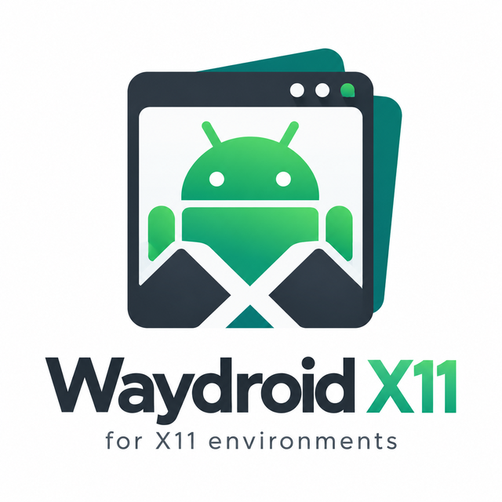

<div align="center">



# xWaydroid

**Run Waydroid (Android) on any X11 desktop with one command.**

No Wayland session needed. No manual Weston juggling. Just `xwaydroid`.

[](https://github.com/P0r0ro/xWaydroid/releases)
[](LICENSE)
[](https://github.com/P0r0ro/xWaydroid/actions/workflows/shellcheck.yml)


</div>

---

## The problem

[Waydroid](https://waydro.id) runs a full Android system in a container on Linux, but it **only works on Wayland**. If you use an X11 session (KDE Plasma X11, Xfce, Cinnamon, MATE, i3, Openbox, …) running `waydroid show-full-ui` gives you nothing, and the usual fix is a recipe you have to remember every time:

```bash
weston --backend=x11-backend.so --socket=mysocket &
WAYLAND_DISPLAY=mysocket waydroid show-full-ui
```

…plus starting the container, stopping stale sessions, cleaning up afterwards, and so on.

## The solution

**xWaydroid** does all of that for you:

1. Installs everything Waydroid needs on your distro (first run only).
2. Opens a nested **Weston** Wayland window on top of your X11 desktop.
3. Starts the Waydroid session inside it and shows the full Android UI.
4. Stops Android and cleans up when you close the window.

It also adds a **xWaydroid** entry to your application menu.

## Quick install

**One-liner** (installs to `~/.local/bin`, sets everything up, then launches Android):

```bash
curl -fsSL https://raw.githubusercontent.com/P0r0ro/xWaydroid/main/install.sh | bash
```

**Or from a clone:**

```bash
git clone https://github.com/P0r0ro/xWaydroid.git
cd xWaydroid
./install.sh
```

The installer will:

- copy `xwaydroid` to `~/.local/bin` (user-owned and already in `PATH` on most distros, so no root files are touched),
- install the icon and the `.desktop` launcher,
- install **waydroid**, **weston** and **wl-clipboard** with your package manager (asks for your password),
- run `waydroid init` if Android images are not downloaded yet (about 1 GB),
- enable the `waydroid-container` service,
- launch Android.

| Installer flag  | What it does                                            |
|-----------------|---------------------------------------------------------|
| `--system`      | Install to `/usr/local/bin` for all users               |
| `--no-launch`   | Install and set up, but don't start Android afterwards  |
| `--gapps`       | Initialize Waydroid with Google Play (GApps) images     |
| `-y`, `--yes`   | Don't ask for confirmation                              |
| `--uninstall`   | Remove xWaydroid (Waydroid itself stays installed)      |

## Usage

```bash
xwaydroid                       # start Android in a 1280x800 window
xwaydroid --fullscreen          # start fullscreen
xwaydroid -W 1920 -H 1080       # custom window size
xwaydroid --app org.fdroid.fdroid   # launch one app instead of the full UI
xwaydroid --software            # CPU rendering (fixes black screens on some GPUs)
xwaydroid stop                  # stop Android and close the window
xwaydroid doctor                # check that everything is set up correctly
xwaydroid setup [--gapps]       # (re)install requirements / initialize images
xwaydroid --help
```

Close the Weston window (or press <kbd>Ctrl</kbd>+<kbd>C</kbd> in the terminal) to shut Android down. Use `--keep-running` if you want the Android session to stay alive in the background.

If you are already on a **Wayland** session, `xwaydroid` notices and simply runs `waydroid show-full-ui` directly.

### Configuration

Defaults can be saved in `~/.config/xwaydroid/config`:

```bash
WIDTH=1600
HEIGHT=900
FULLSCREEN=0
WESTON_SHELL=kiosk     # kiosk = Android fills the window, desktop = classic Weston desktop
RENDERER=auto          # auto | pixman (software rendering)
STOP_ON_EXIT=1         # stop the Android session when the window closes
```

Each setting can also be passed as an environment variable with an `XWAYDROID_` prefix, for example `XWAYDROID_FULLSCREEN=1 xwaydroid`.

## Supported distributions

xWaydroid works on any Linux distro running an **X11** session with a kernel that has **binder** support.

| Distro family              | Package manager | Notes                                                    |
|----------------------------|-----------------|----------------------------------------------------------|
| Fedora / Nobara / RHEL-likes | `dnf`         | Waydroid is in the official repos                        |
| Debian / Ubuntu / Mint / Pop!_OS / Zorin | `apt` | Adds the official `repo.waydro.id` repository if needed |
| Arch / Manjaro / EndeavourOS / Garuda | `pacman` | Uses `yay`/`paru` for the AUR if needed; use a binder-enabled kernel (e.g. `linux-zen`) |
| openSUSE Tumbleweed        | `zypper`        |                                                          |
| Void Linux                 | `xbps`          |                                                          |
| Alpine / postmarketOS      | `apk`           |                                                          |
| Solus                      | `eopkg`         |                                                          |
| NixOS                      | —               | Set `virtualisation.waydroid.enable = true;` and add `weston` |

Tested on Fedora 44 KDE Plasma (X11), Weston 15, Waydroid 1.6.

## How it works

```
 X11 desktop (Xorg)
 └── Weston window  (weston --backend=x11-backend.so --shell=kiosk-shell.so --socket=xwaydroid-0)
     └── Wayland socket $XDG_RUNTIME_DIR/xwaydroid-0
         └── waydroid session  (WAYLAND_DISPLAY=xwaydroid-0)
             └── Android full UI
```

Weston logs are written to `~/.local/state/xwaydroid/weston.log` and Waydroid session logs to `~/.local/state/xwaydroid/session.log`.

## Troubleshooting

Run `xwaydroid doctor` first. It checks the X11 display, Weston, Waydroid, images, the container service and kernel binder support.

| Problem | Fix |
|---------|-----|
| Black or frozen window | `xwaydroid --software` (CPU rendering). On **NVIDIA** proprietary drivers Waydroid itself also needs software rendering: see the [Waydroid docs](https://docs.waydro.id). |
| `Weston failed to start` | Check `~/.local/state/xwaydroid/weston.log`. Make sure the Weston X11 backend is installed (on some distros it is a separate package). |
| `No binder support` | Your kernel lacks binder. Use a kernel that ships it (Fedora, Ubuntu and `linux-zen` do) or install the `binder_linux` DKMS module. |
| `already running` | `xwaydroid stop`, then start again. |
| Apps open in separate tiny windows | `waydroid prop set persist.waydroid.multi_windows false` |
| Want Google Play | `sudo waydroid init -f -s GAPPS`, then [certify the device](https://docs.waydro.id/faq/google-play-certification). |
| Mouse feels off / want a resizable desktop | `xwaydroid --desktop-shell` |

## Uninstall

```bash
./install.sh --uninstall          # or: curl -fsSL https://raw.githubusercontent.com/P0r0ro/xWaydroid/main/install.sh | bash -s -- --uninstall
```

This removes only xWaydroid. To remove Waydroid too, uninstall the `waydroid` package and delete `/var/lib/waydroid` and `~/.local/share/waydroid`.

## Contributing

Bug reports, distro fixes and pull requests are welcome! Please run [ShellCheck](https://www.shellcheck.net/) on your changes (`shellcheck xwaydroid install.sh`). CI runs it on every push.

If xWaydroid works (or doesn't) on your distro, open an issue so the table above can be updated.

## License

[GPL-3.0](LICENSE) © P0r0ro. xWaydroid is a community helper and is not affiliated with the Waydroid project.

<sub>Keywords: waydroid x11, waydroid xorg, run android on linux x11, waydroid without wayland, waydroid weston nested, waydroid kde x11, waydroid xfce, waydroid cinnamon, waydroid i3, android emulator linux, anbox alternative.</sub>
